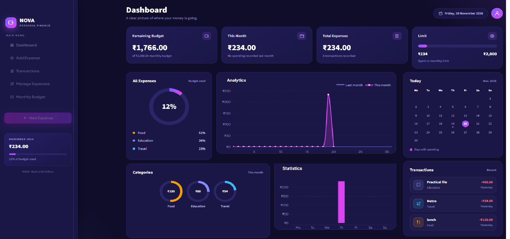

# 💰 NOVA – Expense Tracker

**NOVA** is a personal finance and expense tracking web application developed using Python. It helps users record daily expenses, manage monthly budgets, and visualize their spending habits through an interactive dashboard.

## 🚀 Features

- **Dashboard:** View your financial overview in one place.
- **Add Expenses:** Record expenses with name, amount, category, date and other details.
- **Transactions:** View your expense history.
- **Manage Expenses:** Edit and delete existing transactions.
- **Monthly Budget:** Set and monitor your monthly spending limit.
- **Expense Analytics:** Visualize spending through interactive charts.
- **Category Analysis:** Track expenses across different categories.
- **Daily Spending:** Analyze daily spending patterns.
- **CSV Export:** Export expense records for further analysis.
- **Dark Theme UI:** Clean and modern finance dashboard.

## 🛠️ Technologies Used

| Technology | Purpose |
|---|---|
| Python | Core programming language |
| Streamlit | Web application interface |
| SQLite | Local database management |
| Pandas | Data handling and analysis |
| Plotly | Interactive charts and visualizations |

## 📸 Application Dashboard

The dashboard provides an overview of:
- Remaining monthly budget
- Total expenses
- Monthly spending
- Category-wise expense distribution
- Daily spending analytics
- Recent transactions

## ⚙️ Installation & Setup

### 1. Clone the repository

```
